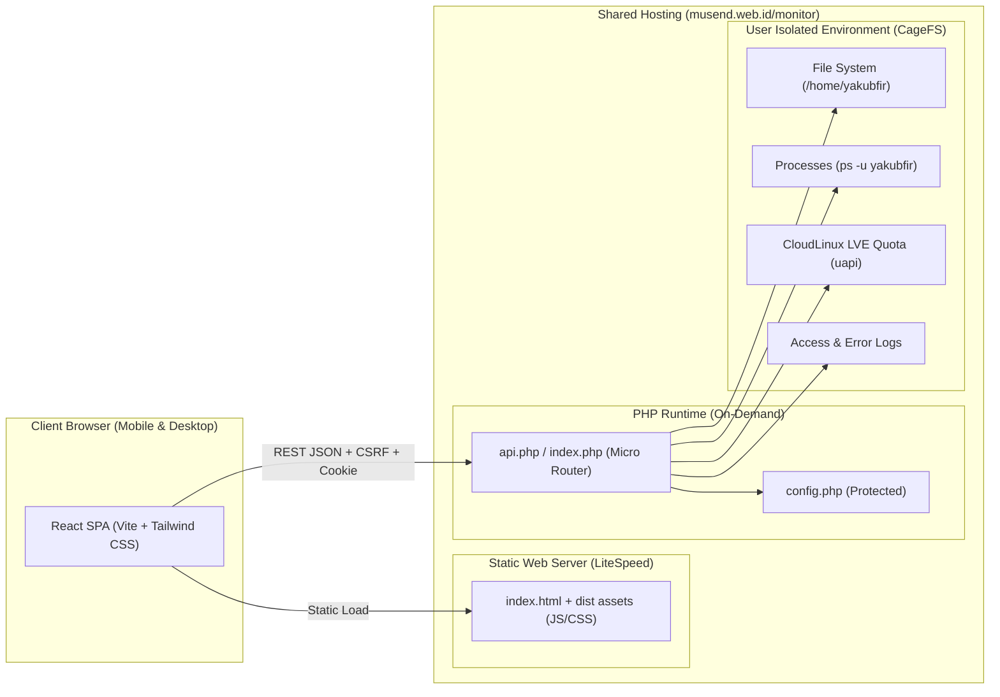

# Product Requirement Document (PRD)
## ServerDeck: Lightweight Web-based Server & Hosting Management Panel

* **Version:** 1.0.0
* **Author:** Yakub Firman Mustofa & Pair Assistant
* **Target Environment:** Shared/Cloud Hosting (CloudLinux / cPanel / LiteSpeed)
* **Architecture:** Static React SPA (Vite + Tailwind CSS + Lucide) + Micro PHP REST API (Zero-Daemon Backend)

---

## 1. Executive Summary

### 1.1 Problem Statement
Pengguna shared hosting (cPanel/CloudLinux) sering kali merasa antarmuka cPanel terlalu berat, berbelit-belit, dan menyajikan metrik fisik server node (misal 64 GB RAM, puluhan core CPU) yang membingungkan alih-alih menampilkan alokasi paket hosting yang dibeli. Selain itu, manajemen file cepat, editing script, dan monitoring proses background membutuhkan pengalaman antarmuka modern yang responsif layaknya SaaS/VPS panel (aaPanel/CyberPanel).

### 1.2 Solution
**ServerDeck** adalah dashboard manajemen file, proses, dan performa hosting mandiri yang ringan (*zero background memory footprint* saat idle) dengan:
1. **Frontend:** React 18+ (SPA) dibangun menggunakan Vite & Tailwind CSS, di-build menjadi file HTML/JS/CSS statis.
2. **Backend:** Micro REST API PHP murni (PHP 8.2+) tanpa daemon Node.js yang berjalan terus-menerus, sehingga **menghemat 100% kuota RAM dan NPROC hosting**.
3. **Hosting-Scoped Metrics:** Membaca langsung limit kuota CloudLinux LVE pengguna (`4 GB RAM`, `100% CPU / 1 Core`, `NPROC 400`, `EP 60`, `32 MB/s I/O`) via cPanel UAPI cache.

---

## 2. System Architecture



### 2.1 Technology Stack

| Layer | Teknologi | Alasan Pemilihan |
| :--- | :--- | :--- |
| **Frontend Framework** | React 18+ (TypeScript) | Ekosistem komponen kaya, tipe data aman, fleksibel. |
| **Bundler & Tooling** | Vite | Build time super cepat, output bundle kecil & optimal. |
| **Styling** | Tailwind CSS + Lucide Icons | Utility-first, tema dark mode modern, responsif. |
| **Code Editor Component** | Monaco Editor / CodeMirror 6 | Editor teks kode in-browser dengan syntax highlight & shortcut. |
| **State & Data Fetching** | TanStack Query (React Query) | Auto-polling status, caching cerdas, zero redundant request. |
| **Backend Runtime** | PHP 8.2 / 8.5 (Native / Micro-router) | Zero background idle RAM, didukung penuh oleh LiteSpeed LSAPI. |
| **Deployment Target** | `/home/yakubfir/musend.web.id/monitor` | Langsung disajikan via HTTPS aktif (*SSL Let's Encrypt*). |

---

## 3. Detailed Functional Specifications

### 3.1 Authentication & Security Module
* **Features:**
  * Login form dengan validasi credential (`username` & `password`).
  * **Password Visibility Toggle:** Tombol ikon mata (*show/hide password*).
  * **Case-Insensitive Username Check:** Mencegah gagal login akibat keyboard mobile auto-capitalization.
  * **Flexible End Punctuation Tolerance:** Menangani ketikan password dengan atau tanpa tanda titik penutup.
  * **Session Management:** Secure Cookie (`HttpOnly`, `SameSite=Lax`, `Secure` pada HTTPS).
  * **CSRF Protection:** Token acak unik per sesi untuk seluruh mutasi data (`POST`, `PUT`, `DELETE`).
  * **Brute-Force Rate Limiting:** Pembatasan percobaan login (maks 5 kali gagal per IP per menit).
  * **Configuration Lockdown:** `.htaccess` memblokir akses langsung publik ke file `config.php` (HTTP 403).

### 3.2 Hosting Resource & Performance Monitor
Menampilkan metrik yang **secara ketat dibatasi pada paket hosting pengguna**, bukan node server induk:
* **CPU Paket Hosting:**
  * Penggunaan CPU LVE real-time terhadap limit paket (100% / 1 CPU Core).
  * Server load average (1m, 5m, 15m) sebagai info pelengkap.
* **RAM Paket Hosting (Physical Memory Quota):**
  * Penggunaan memori fisik real-time terhadap alokasi hosting (misal `930 MB / 4.00 GB`).
  * Penggunaan memori skrip PHP aktif.
* **Penyimpanan & File Quota:**
  * Total byte direktori `/home/yakubfir` terpakai (misal `1.44 GB`).
  * Status kuota disk (*Unmetered* / kuota terukur).
  * Jumlah inode terpakai (misal `~38.918 file`).
* **Batas Jumlah Proses (NPROC & Entry Processes):**
  * Jumlah proses pengguna terhadap limit CloudLinux LVE (misal `170 / 400 NPROC`).
  * Entry Processes aktif terhadap limit (misal `5 / 60 EP`).
* **I/O Speed & IOPS:**
  * Kecepatan baca/tulis disk terhadap limit (misal `Batas 32 MB/s`).
  * Batas IOPS (misal `4.096 IOPS`).
* **Bandwidth & Domain:**
  * Bandwidth terpakai bulan berjalan (misal `~516 MB`).
  * Kuota Addon Domain (`1 / 4`) dan Subdomain aktif.

### 3.3 File & Directory Management (File Explorer)
* **Breadcrumb & Quick Navigation:** Navigasi hirarkis dengan shortcut instan ke `~ Home`, `musend.web.id`, `public_html`, dan `logs`.
* **Path Traversal Protection:** Validasi kanonikal (`realpath`), memastikan tidak bisa mengakses di luar `/home/yakubfir`.
* **File Listing & Sorting:**
  * Kolom: Icon ekstensi, Nama, Ukuran (Bytes/KB/MB), Permissions (chmod), Tanggal modifikasi.
  * Pencarian / filter file secara instan.
* **Operasi File & Direktori:**
  * **Create:** File baru atau folder baru.
  * **Upload:** Multi-file drag-and-drop dengan progress bar.
  * **Edit:** Modal Monaco/CodeMirror code editor lengkap dengan line number, syntax highlighting, dan shortcut `Ctrl + S`.
  * **Download:** Direct streaming attachment.
  * **Rename & Chmod:** Pengubahan nama dan hak akses octal (`0755`, `0644`).
  * **Delete:** Hapus file atau rekursif folder (dengan proteksi terhadap root `/home/yakubfir`).
  * **Kompresi ZIP:** Kompresi multi-item terpilih menjadi `.zip` via `ZipArchive` PHP.
  * **Ekstraksi ZIP:** Ekstrak langsung file `.zip` ke folder target.

### 3.4 Process Manager
* Menampilkan daftar proses akun yang sedang berjalan (`ps -u yakubfir -o pid,ppid,%cpu,%mem,time,comm,args`).
* Pencarian proses berdasarkan PID atau nama skrip/perintah.
* Tombol **Kill Process** (`SIGTERM` / `SIGKILL`) dengan verifikasi kepemilikan UID.

### 3.5 Web Console / Terminal Runner
* Eksekusi perintah command-line aman di dalam lingkungan pengguna (`git status`, `composer`, `node -v`, `npm`, `php`, dll).
* Histori perintah (panah atas/bawah keyboard) dan tombol pintas (*preset buttons*).

### 3.6 Real-Time Log Viewer
* Streaming tail 100/250/500 baris terakhir dari:
  * `musend.web.id` SSL Access Log
  * `yakubfirman.com` SSL Access Log
  * `api.yakubfirman.com` SSL Access Log
  * `php.error.log`

---

## 4. API Contract & Endpoints

Base URL: `/monitor/api/` (atau `api.php?endpoint=...`)

| Method | Endpoint | Deskripsi | Parameter Utama |
| :--- | :--- | :--- | :--- |
| `POST` | `auth/login` | Login pengguna | `username`, `password` |
| `GET` | `auth/check` | Cek status sesi & CSRF token | - |
| `POST` | `auth/logout` | Menghancurkan sesi | - |
| `GET` | `stats` | Mengambil metrik LVE & performa hosting | - |
| `GET` | `files/list` | Menampilkan isi direktori | `path` |
| `GET` | `files/read` | Membaca isi file teks | `path` |
| `POST` | `files/save` | Menyimpan perubahan isi file | `path`, `content`, `csrf_token` |
| `POST` | `files/create` | Membuat file atau folder | `dir`, `name`, `type`, `csrf_token` |
| `POST` | `files/delete` | Menghapus file atau folder | `path`, `csrf_token` |
| `POST` | `files/rename` | Mengubah nama file/folder | `old_path`, `new_name`, `csrf_token` |
| `POST` | `files/chmod` | Mengubah permission | `path`, `mode`, `csrf_token` |
| `POST` | `files/upload` | Mengunggah file | `dir`, `files[]`, `csrf_token` |
| `GET` | `files/download` | Mengunduh file mentah | `path` |
| `POST` | `files/zip` | Mengompres item terpilih | `dir`, `zip_name`, `items[]`, `csrf_token` |
| `POST` | `files/unzip` | Mengekstrak file zip | `path`, `csrf_token` |
| `GET` | `processes/list`| Daftar proses aktif user | - |
| `POST` | `processes/kill`| Menghentikan proses | `pid`, `signal`, `csrf_token` |
| `POST` | `terminal/run` | Menjalankan perintah bash | `cmd`, `cwd`, `csrf_token` |
| `GET` | `logs/tail` | Membaca tail log | `type`, `lines` |
| `POST` | `settings/password` | Mengganti kata sandi | `old_password`, `new_password`, `csrf_token` |

---

## 5. Local Development & Project Directory Structure

Rekomendasi struktur direktori di repositori Git:

```text
serverdeck/
├── .github/
│   └── workflows/
│       └── deploy.yml              # CI/CD otomatis (opsional via FTP/SSH)
├── backend/
│   ├── api.php                     # Micro REST API router
│   ├── config.sample.php           # Template konfigurasi
│   ├── .htaccess                   # Proteksi akses file sensitif
│   └── src/
│       ├── Auth.php                # Autentikasi & session handling
│       ├── Files.php               # Operasi file manager & zip
│       ├── Metrics.php             # CloudLinux LVE & system metrics
│       └── System.php              # Process & terminal runner
├── frontend/
│   ├── public/
│   │   └── favicon.svg
│   ├── src/
│   │   ├── assets/
│   │   ├── components/             # Sidebar, Navbar, StatCard, Modals
│   │   │   ├── EditorModal.tsx     # Code editor component
│   │   │   ├── UploadModal.tsx     # File uploader
│   │   │   └── Terminal.tsx        # Terminal console
│   │   ├── hooks/                  # Custom hooks (useStats, useFiles)
│   │   ├── pages/                  # Overview, Files, Processes, Logs, Settings
│   │   ├── services/               # API axios/fetch client
│   │   ├── types/                  # TypeScript interface definitions
│   │   ├── App.tsx
│   │   └── main.tsx
│   ├── index.html
│   ├── package.json
│   ├── tailwind.config.js
│   ├── tsconfig.json
│   └── vite.config.ts              # Proxy config untuk local dev
├── dist/                           # Output build Vite (disalin ke public hosting)
└── README.md
```

### 5.1 Local Development Workflow
1. **Jalankan Backend Lokal (PHP):**
   ```bash
   cd backend
   php -S 127.0.0.1:8000
   ```
2. **Jalankan Frontend Lokal (Vite):**
   ```bash
   cd frontend
   npm install
   npm run dev
   ```
   *(Konfigurasi `vite.config.ts` mem-proxy `/api` ke `http://127.0.0.1:8000`).*
3. **Build untuk Produksi:**
   ```bash
   cd frontend
   npm run build
   # Hasil folder dist/ digabungkan dengan backend/ untuk diunggah ke hosting
   ```

---

## 6. Non-Functional Requirements & Security

1. **Zero Background Resource Footprint:** Backend tidak memerlukan daemon Node.js terus-menerus. Memori hanya dikonsumsi saat ada HTTP request dan langsung dibebaskan kembali oleh LiteSpeed.
2. **Sandbox Boundary:** Skrip berjalan di bawah isolasi CloudLinux CageFS user `yakubfir`.
3. **Response Time:** API metrik di-cache selama 10-15 detik agar antarmuka instan tanpa membebani server query cPanel UAPI.
4. **Mobile Responsiveness:** Tampilan harus nyaman digunakan pada smartphone melalui drawer navigation dan tabel yang dapat di-scroll horizontal.
